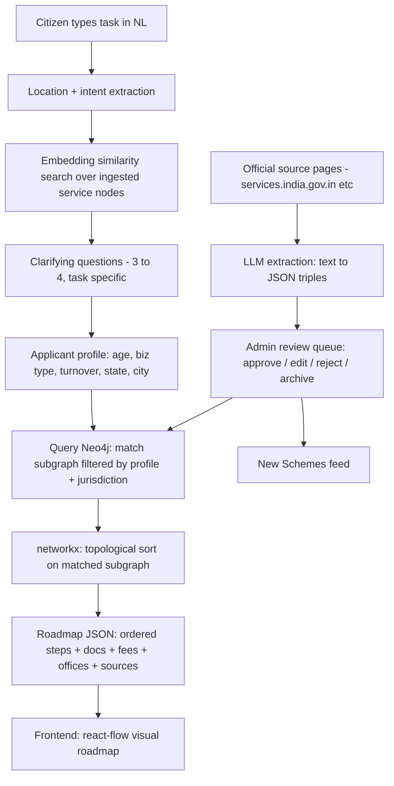

# Nagrik Marg — Civic Task Navigator
### PS ID: PSWB02 | TSEC Internal Hackathon 2026-27 | Computer Engineering Dept

> "Nagrik Marg" = "Citizen's Path" — working name, change if the team prefers.

---

## 1. Elevator Pitch (memorize this, say it first in the demo)

> "Government portals answer questions once you already know the exact service name.
> We built the opposite: a citizen types what they actually want in plain language —
> in any Indian language — and we return an ordered, personalized, jurisdiction-aware
> roadmap of every step, document, fee, and office involved, grounded in real official
> sources and readable by someone who's never filled a government form before."

**The gap we found:** ServicePlus (the platform behind most state e-service portals) and
UMANG (~660 services across 127 departments) are both **service-first** — you must
already know what you're looking for. Nobody does **task-first decomposition**. That's
our whole pitch.

---

## 2. Problem Statement Recap

**PSWB02 — Municipal Bureaucracy Path Visualizer.** Users describe a civic task in
natural language; the system aggregates fragmented government info and generates a
visual, step-by-step dependency roadmap of forms, offices, and prerequisites, with an
admin dashboard to review/validate extracted data.

---

## 3. USPs — What We Say Out Loud in the Demo

**Build-and-show-live (say these with a straight face, they're real):**
- **Grounded, not hallucinated** — every step traces to a cited official source URL.
- **Personalized by rule, not by guess** — an `Applicant` profile (age, business type,
  turnover, state, city) changes which roadmap comes back for the *same* typed task.
- **Jurisdiction-aware** — same task, different state/city → different fees, forms,
  offices, live in the demo (Thane vs. another city/state).
- **Honest about gaps** — when confidence is low, it says so instead of hallucinating.
- **Total cost + time upfront** — sums fees/days across the whole path, not per-service.
- **Accessible by design** — document reference images + audio captions + voice
  input/output via Bhashini, for citizens who can't read dense government text.
- **New Schemes feed** — reuses the exact same review pipeline; filtered by the
  citizen's own eligibility profile, not just a generic list.

**Closing-slide vision lines (say these as "where this goes next," don't over-claim):**
- One parser template, many states — most state portals run on the same ServicePlus
  platform, so ingestion scales nationally without per-state rewrites.
- Voice-first, for citizens with no reading ability at all (Bhashini STT + TTS chained).
- Crowdsourced correction over time — "Wikipedia for government processes."
- Cross-task deduplication — one address-proof requirement, reused across three tasks.
- Offline-first PWA caching for low-connectivity citizens.

---

## 4. Full Feature List (tagged by priority)

`MVP` = must work live in the demo | `SHOULD` = build if time allows | `VISION` = say it, don't build it

| Feature | Tag |
|---|---|
| Natural-language task query box | MVP |
| Location auto-extracted from query text (fallback: ask) | MVP |
| 3–4 dynamic clarifying questions per task | MVP |
| Knowledge graph: nodes = forms/docs/offices/fees, edges = dependencies | MVP |
| Topological sort → ordered visual roadmap (react-flow) | MVP |
| Applicant profile node (age, business type, turnover, state, city) | MVP |
| Conditional/rule edges (different reqs per profile) | MVP |
| Jurisdiction levels: central / state / municipal / local | MVP |
| State + city switcher live in demo (2 states, 2–3 cities) | MVP |
| In-memory embeddings + cosine similarity for task → service matching | MVP |
| LLM extraction pipeline (official source text → JSON triples) | MVP |
| Admin review dashboard (approve/edit/reject/archive, risk tiers) | MVP |
| Confidence score + "insufficient coverage" honest fallback | MVP |
| Cost + processing-day rollup across full roadmap | MVP |
| Document reference images per doc type + plain-language captions | SHOULD |
| Bhashini text translation (multilingual UI + query) | SHOULD |
| Offline/hybrid step type: nearest office + designated contact (PIO/RTI-based) | SHOULD |
| Versioned history on every node (old value → new value → who approved) | SHOULD |
| New Schemes feed, filtered by applicant eligibility | SHOULD |
| "Explore themes" interest queue | SHOULD |
| Bhashini voice (STT/TTS) | VISION |
| Persistent user profile across sessions (needs auth) | VISION |
| Offline-first PWA caching | VISION |
| Cross-task requirement deduplication | VISION |
| Push notifications for new schemes | VISION |

---

## 5. Architecture Overview



**Two pipelines, cleanly separated:**
1. **Ingestion (backend-heavy, async/offline):** source → LLM extraction → review queue → graph.
2. **Query (live, user-facing):** task text → retrieval → clarify → graph query → ordered roadmap.

---

## 6. Tech Stack

| Layer | Choice | Why |
|---|---|---|
| Frontend framework | React + Tailwind | Fast to build, team likely already knows it |
| Roadmap visualization | `react-flow` | Purpose-built for node/edge step diagrams |
| Backend | Python + FastAPI | Pairs cleanly with embeddings/graph libs, fast to stand up |
| Graph database | Neo4j AuraDB Free (cloud) | No install, scales past hackathon scope, native path queries via Cypher |
| Graph algorithms | `networkx` (on the matched subgraph only) | One-line topological sort, no need to do this in Cypher |
| Extraction / reasoning | LLM API (Claude or GPT via API key) | Structured JSON-triple extraction from source text |
| Embeddings | `sentence-transformers` (free/local) or OpenAI embeddings | Task-to-service retrieval, no vector DB needed at this scale |
| Multilingual | Bhashini API (bhashini.gov.in) | Free, govt-backed, strong "data sovereignty" narrative for judges |
| Auth | Skip for hackathon — session-only | Full auth is scope creep for 2 days |
| Hosting (frontend) | Vercel / Netlify | Push-to-deploy, zero config |
| Hosting (backend) | Render / Railway | Same, free tier is enough |
| Version control | GitHub, branch-per-person | See Section 9 |

---

## 7. Data Schema / API Contract

**Agree on this FIRST, before anyone writes code — it's what lets 4 people work in parallel without blocking each other.**

### 7.1 Service Node
```json
{
  "id": "svc_fssai_basic_reg",
  "name": "FSSAI Basic Registration",
  "citizen_friendly_label": "Food safety registration (small business)",
  "category": "food_business",
  "jurisdiction_level": "central",
  "applicable_region": null,
  "mode": "online",
  "documents_required": ["doc_aadhaar", "doc_address_proof"],
  "fee": 100,
  "processing_days": 7,
  "official_source_url": "https://...",
  "office_name": null,
  "office_address": null,
  "contact_designation": null,
  "confidence": 0.92,
  "status": "approved",
  "date_added": "2026-09-20",
  "version_history": []
}
```

### 7.2 Edge Types
`requires`, `prerequisite_for`, `issued_by`, `eligible_if`, `alternative_to`

### 7.3 Applicant Profile
```json
{
  "state": "Maharashtra",
  "city": "Thane",
  "age": 29,
  "business_premises": "home",
  "ownership": "rented",
  "food_type": "packaged_snacks",
  "annual_turnover_bracket": "under_12L"
}
```

### 7.4 Core API Endpoints (backend teammate owns these)
```
POST /api/query          { task_text, applicant_profile }  -> { clarifying_questions[] } or { roadmap }
POST /api/clarify        { session_id, answers[] }         -> { roadmap }
GET  /api/graph/:node_id                                    -> node detail
POST /api/admin/review    { node_id, action, edits }        -> updated node
GET  /api/admin/queue                                       -> pending review items
GET  /api/schemes/new     { applicant_profile }              -> ranked new schemes
```

---

## 8. Folder Structure

```
nagrik-marg/
├── frontend/
│   ├── src/
│   │   ├── components/
│   │   │   ├── QueryBox/
│   │   │   ├── ClarifyingQuestions/
│   │   │   ├── RoadmapView/          (react-flow)
│   │   │   ├── DocumentGuide/        (images + captions)
│   │   │   ├── SchemesFeed/
│   │   │   └── AdminDashboard/
│   │   ├── hooks/
│   │   ├── services/api.js
│   │   └── App.jsx
│   └── public/assets/document-images/
├── backend/
│   ├── app/
│   │   ├── main.py               (FastAPI entrypoint)
│   │   ├── routers/
│   │   │   ├── query.py
│   │   │   ├── admin.py
│   │   │   └── schemes.py
│   │   ├── graph/
│   │   │   ├── neo4j_client.py
│   │   │   └── subgraph_ops.py   (networkx topological sort)
│   │   ├── retrieval/
│   │   │   └── embeddings.py
│   │   ├── extraction/
│   │   │   ├── source_registry.json
│   │   │   └── llm_extractor.py
│   │   └── models/schema.py
│   └── requirements.txt
├── data/
│   ├── seed_services/             (curated source text + extracted JSON per city/task)
│   └── document_images/
├── docs/
│   └── PROJECT_MASTER_DOC.md      (this file)
└── presentation/
    ├── pitch_deck.pptx
    └── demo_script.md
```

---

## 9. Git Workflow

- `main` — protected. Only demo-ready, working code. Merge via PR only.
- `backend` — backend teammate's working branch.
- `frontend` — frontend teammate's working branch.
- `design` — design/PPT teammate's branch (assets, document images, pitch deck source, Figma exports).
- `integration` — your branch. Pull `backend` + `frontend` in here, wire them together end-to-end, resolve conflicts, THEN merge `integration` → `main`.

**Rule:** nobody merges straight into `main` except from `integration`, after it's been tested end-to-end. Commit early, commit often, push at least every 2–3 hours so nothing is lost.

---

## 10. Team Roles — Individual Docs

### 10.1 You — Full-stack + Integration Lead
- Own the API contract (Section 7) — finalize it in the first hour so backend/frontend don't block each other.
- Build the retrieval layer (embeddings + cosine similarity) and the query orchestration (`/api/query`, `/api/clarify`).
- Own the `integration` branch: merge backend + frontend, wire real API calls in place of any mocked data.
- Final say on cut-list decisions (Section 13) if time runs short.
- Own the live demo run-through (Section 12) — rehearse it twice before judging.

### 10.2 Backend Teammate
**Owns:** graph, extraction, admin logic.
- Set up Neo4j AuraDB Free, load the schema from Section 7.1.
- Build the LLM extraction pipeline: source text → JSON triples → insert via Cypher.
- Build `subgraph_ops.py`: given a matched set of node IDs, pull the subgraph from Neo4j and run `networkx.topological_sort()` on it.
- Build `/api/admin/queue` and `/api/admin/review` (approve/edit/reject/archive + risk tiers per the dashboard doc already discussed).
- Seed data: manually curate 2 states × 2–3 cities × 3 tasks worth of source text (this is the single most time-sensitive task — start this in the first hour).

### 10.3 Frontend Teammate
**Owns:** the citizen-facing UI.
- `QueryBox` — task input + location auto-detect display.
- `ClarifyingQuestions` — dynamic question renderer from backend response.
- `RoadmapView` — react-flow rendering of the ordered roadmap, with online/offline node styling (different icon/color per `mode`).
- `DocumentGuide` — modal/panel showing document reference image + caption per step.
- Build against the mocked JSON in Section 7.1 FIRST — don't wait on backend, use static fixtures, swap in real API calls once integration lead wires it up.

### 10.4 Design + Frontend-Inspo + PPT Teammate
**Owns:** visual language + the pitch itself.
- Source/curate the **document reference images** (generic sample docs — Aadhaar, electricity bill, rent agreement mockups; never a real person's real document) → drop into `/data/document_images/` with filenames matching `doc_*` IDs from Section 7.1.
- Pull UI inspo (Dribbble/Mobbin references for step-by-step wizards, roadmap/timeline UI patterns) and hand mockups/Figma to the frontend teammate — align on a simple color/type system early so it doesn't get restyled twice.
- Own `presentation/pitch_deck.pptx`: elevator pitch (Section 1) → problem → USPs (Section 3) → live demo → architecture (Section 5, simplified) → vision/closing lines.
- Own `presentation/demo_script.md` — write the exact click-by-click narration for Section 12 so whoever demos doesn't fumble live.
- Write 1-slide "why this matters" using real numbers if possible (e.g., number of services on services.india.gov.in, UMANG's scale) — grounds the pitch instead of sounding hypothetical.

---

## 11. TONIGHT'S TIMELINE — 3:15 PM to 6:00 AM (revised, urgent)

**This is the real schedule.** Full per-person breakdowns are in each person's own doc
(Section 16). This is the shared master grid — everyone should have it open.

| Time | Block | What happens |
|---|---|---|
| 15:15–15:45 | Kickoff | Lock the Section 7 schema. No changes to node/edge shape after this — everyone builds against it as-is. |
| 15:45–17:00 | Build 1 | Backend: Neo4j + seed data start. Frontend: scaffold + fixtures. Design: doc images + inspo. You: retrieval skeleton. |
| 17:00–17:15 | Sync 1 | Status check, unblock anyone stuck. |
| 17:15–19:00 | Build 2 | Backend: extraction pipeline live for task 1. Frontend: RoadmapView + Clarifying Qs. Design: finish task-1 doc images, start deck. You: `/api/query` + `/api/clarify` against real graph. |
| 19:00–19:30 | **Dinner — mandatory** | Eat properly. Skipping this costs you more later than it saves now. |
| 19:30–19:40 | Sync 2 | |
| 19:40–21:30 | Build 3 | Backend: admin dashboard + 2nd city seed. Frontend: state/city switcher + doc guide panel. Design: New Schemes visuals, deck to 60%. You: wire frontend↔backend, test task 1 end-to-end. |
| 21:30–21:45 | Sync 3 | **First full group test** — run task 1 live as a group, list every bug. |
| 21:45–23:30 | Build 4 | Fix bugs from Sync 3. Backend: seed task 2/3. Frontend: polish + error states. Design: deck to 90%. |
| 23:30–00:00 | Sync 4 + break | Snacks/coffee. Energy dips here — regroup deliberately. |
| 00:00–01:30 | Build 5 | Should-have features only if on schedule (versioned history, New Schemes feed). Integration: first functional full run-through. |
| 01:30–02:00 | Sync 5 | **HARD FEATURE FREEZE.** Nothing new gets built after this point, no matter how good the idea is. |
| 02:00–03:00 | Stabilize | Bug fixes only. Design finalizes deck + writes final demo script. |
| 03:00–03:30 | Break | Food/water/stretch. Stagger a short nap if anyone truly needs it — better one person sharp for 20 min than everyone foggy. |
| 03:30–04:15 | **Rehearsal 1** | Full demo + pitch, live, timed, everyone watching. Write down every stumble. |
| 04:15–04:45 | Fix pass | Fix only what rehearsal 1 exposed. |
| 04:45–05:15 | **Rehearsal 2** | Full run-through again, timed. This one should feel smooth. |
| 05:15–05:45 | Final polish | Export deck as PDF backup, screen-record the demo as a video backup (wifi/projector fails happen), charge every device. |
| 05:45–06:00 | Wrap | Pack up, be ready. |

---

## 12. Demo Script (the scenario to run live)

1. Type: *"I want to start a home-based food business in Thane."*
2. Show 3–4 clarifying questions appear (premises type, ownership, food type, turnover).
3. Answer them → roadmap appears: ordered steps, each showing fee/days/source link, online vs. offline styling.
4. Click a document step → show the document reference image + caption.
5. **Switch state/city** (e.g., Thane → another city) live → show the roadmap change (different office, different fee).
6. Open the **Admin Dashboard** → show a pending review item, approve it, show version history.
7. Open **New Schemes** feed → show it filtered against the same applicant profile from step 2.
8. Close on the honest-fallback feature: type an unsupported/out-of-scope task → show the "insufficient coverage, flagged" message instead of a hallucinated answer.

---

## 13. Cut List (if you're behind schedule, cut top-down)

1. New Schemes feed
2. "Explore themes" queue
3. Bhashini translation (keep English-only, mention it in the vision slide instead)
4. Document reference images (keep text-only document names if truly out of time)
5. Second state/city (fall back to one, mention multi-jurisdiction in the pitch as designed-for, not shown)
6. Versioned history UI (keep the data field, skip the diff UI)

**Never cut:** the core query → clarify → roadmap flow, and the grounded-source-citation on each step. Those are the whole pitch.

---

## 14. Research References (for the design/PPT teammate's citations slide)

- Promikyridis & Tambouris, *Using Knowledge Graphs to Provide Public Service Information*, DG.O 2022 — https://dl.acm.org/doi/10.1145/3543434.3543585
- *An Event-Centric Knowledge Graph Approach for Public Administration*, MDPI Computers 2024 — https://www.mdpi.com/2073-431X/13/1/17
- *Graph Based E-Government Web Service Composition* — https://arxiv.org/pdf/1111.6401
- Neo4j, *Creating Knowledge Graphs from Unstructured Data* (practical extraction pipeline reference) — https://neo4j.com/developer/genai-ecosystem/importing-graph-from-unstructured-data/
- Bhashini — Government of India's multilingual AI stack — https://bhashini.gov.in
- services.india.gov.in — National Government Services Portal (source registry base)
- Right to Information Act, 2005, Section 4(1)(b)(xvi) — legal basis for the PIO contact-person data source

---

## 15. Final Pitch Checklist

- [ ] Elevator pitch memorized by whoever presents (Section 1)
- [ ] USP list said out loud, not just shown on a slide (Section 3)
- [ ] Live demo rehearsed twice, timed
- [ ] State/city switch shown live, not just described
- [ ] Admin dashboard shown, not just mentioned
- [ ] Honest-fallback moment included — judges remember humility
- [ ] Closing line: name the gap (ServicePlus/UMANG are service-first, we're task-first)

---

## 16. Companion Docs — Read Your Own, Everyone Skims the First One

- `TECHNICAL_DEEPDIVE.md` — **everyone reads this once tonight.** Plain-language explanations of how Neo4j, embeddings/sentence-transformers, cosine similarity, and topological sort actually work, with worked examples — so any of you can field a technical judge question confidently, not just the person who built that part.
- `BACKEND_DOC.md` — full context + task breakdown for the backend teammate.
- `FRONTEND_DOC.md` — full context + task breakdown for the frontend teammate.
- `DESIGN_PPT_DOC.md` — full context + task breakdown for the design/inspo/PPT teammate.
- `INTEGRATION_LEAD_DOC.md` — full context + task breakdown for you.

Each person doc is self-contained on purpose — if you paste just your own doc into your own AI assistant, it has everything it needs to help you without you re-explaining the project.
